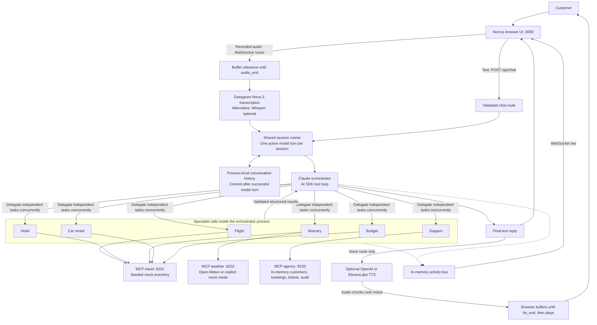

# Current architecture

Verified against the implementation on 2026-10-22. This describes the local
application, not the planned AWS deployment.

## Request lifecycle

1. The browser opens an activity socket and a voice socket using its session ID.
   Typed messages use the HTTP chat endpoint.
2. HTTP validates message and session-ID types and lengths. Voice buffers a
   recorded utterance and transcribes it after `audio_end`; recognition is not
   streamed live to Deepgram.
3. Both paths use the same session runner. A second overlapping model turn is
   rejected (HTTP 409; voice error). The guard does not cover the earlier STT phase.
4. The orchestrator asks clarifying questions or calls registered specialists.
   Specialists are model calls in the same process, not separately deployed workers.
5. Specialists discover and call only their configured MCP servers' tools. Results
   are validated against shared schemas and returned to the orchestrator.
6. The orchestrator produces a final reply; successful turns commit user and
   assistant messages to local memory. Failed turns leave committed history intact.
   Tool side effects are not rolled back.
7. Activity events populate the transcript, results canvas, and agent feed. On
   the voice path, optional synthesis sends audio chunks to the browser, which
   waits for the completed utterance before playback.

## Local startup and checks

`scripts/dev.sh` loads the local environment and launches five processes: the
web app, orchestrator, and three MCP servers. The orchestrator discovers tools
from all three MCP services before listening. Health and readiness endpoints
exist; orchestrator readiness checks cached tool registration, not continuous
upstream health.

GitHub Actions installs dependencies, lints, builds/typechecks, runs deterministic
regression tests, and builds the workspace. It does not deploy the application.
The six new tests do not call live model or speech providers.

## Current boundaries

- Deepgram is used for transcription; Deepgram TTS and Voice Agent API are not wired.
- Speech providers are selected by configuration, not automatic failover.
- History, session locks, activity buffers, and agency data are process-local.
- Session identifiers and origin checks are not user authentication.
- Cancellation targets TTS output; it does not abort the model/tool/STT pipeline.
- Card selection is currently visual-only and does not update agent context.
- Prior execution notes report 60–80-second fan-out turns; this pass did not
  remeasure live latency.
- Redis, Postgres, distributed locks, bounded retention, full tracing/evals,
  containers, Helm, and EKS remain future work.

## October 26 additions

The travel MCP service now exposes vacation-rental search through an independent
Airbnb MCP child process, with time and concurrency limits and search-link fallback.
The existing three-service topology is unchanged. The results UI renders Airbnb
links/listing cards and official itinerary sources. Curated regional guides are
separate from the mock hotel catalog. The live Airbnb check was restricted; no
partner credentials or booking access have been provisioned.
