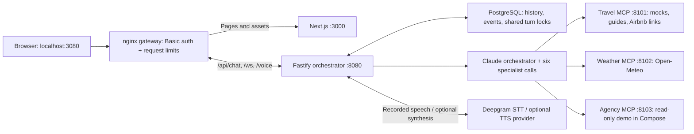
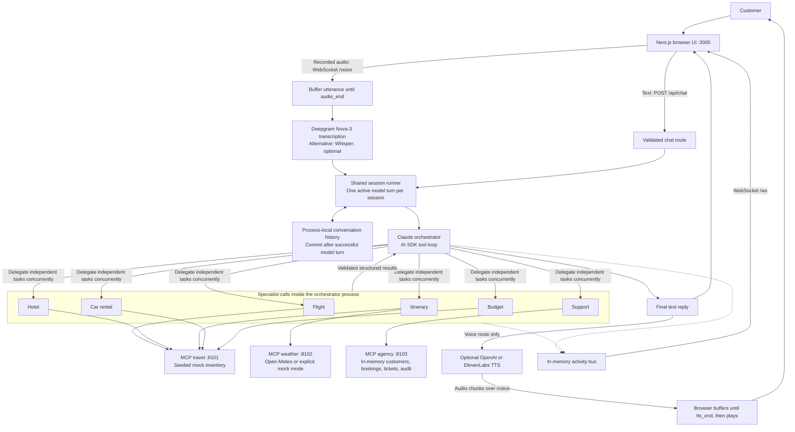

# Current architecture

Container deployment now adds a same-origin authenticated nginx gateway (:3080), PostgreSQL for conversation/event persistence and cross-instance locks, and a read-only demo agency. See [deployment architecture and limits](deploy/README.md). The original process-local mode described below remains available when DATABASE_URL is absent.

Documentation audited on 2026-10-27; runtime verified on 2026-10-26. This describes the local
application, not the planned AWS deployment.

## Current Docker pilot

Only the gateway is published, bound to host loopback. All other ports are internal to Compose. PostgreSQL retains the last 24 conversation messages for 24 hours of inactivity and up to 500 events per session for 24 hours. Shared locks prevent overlapping session turns; four model turns are admitted globally. Events are polled every 500 ms. This is a single-host pilot, without proven high availability or load capacity.

## Direct development flow

The diagram below describes `scripts/dev.sh` without `DATABASE_URL`. In Compose, PostgreSQL replaces the history store and activity bus; authenticated gateway identity scopes session IDs.

## Request lifecycle

1. The browser opens an activity socket and a voice socket using its session ID.
   Typed messages use the HTTP chat endpoint.
2. HTTP validates message and session-ID types and lengths. Voice buffers a
   recorded utterance and transcribes it after `audio_end`; recognition is not
   streamed live to Deepgram.
3. Both paths use the same session runner. A second overlapping model turn is
   rejected (HTTP 409; voice error). The guard does not cover the earlier STT phase.
4. The orchestrator asks clarifying questions or calls registered specialists.
   Specialists are model calls in the same process, not separately deployed workers.
5. Specialists discover and call only their configured MCP servers' tools. Results
   are validated against shared schemas and returned to the orchestrator.
6. The orchestrator produces a final reply; successful turns commit user and
   assistant messages to the configured store (memory or PostgreSQL). Failed turns leave committed history intact.
   Tool side effects are not rolled back.
7. Activity events populate the transcript, results canvas, and agent feed. On
   the voice path, optional synthesis sends audio chunks to the browser, which
   waits for the completed utterance before playback.

## Local startup and checks

`scripts/dev.sh` loads the local environment and launches five processes: the
web app, orchestrator, and three MCP servers. The orchestrator discovers tools
from all three MCP services before listening. Health and readiness endpoints
exist; orchestrator readiness checks cached tool registration, not continuous
upstream health.

GitHub Actions installs dependencies, lints, builds/typechecks, runs deterministic
regression tests, and builds the workspace. It does not deploy the application.
The suite contains 14 tests, including gateway authentication and PostgreSQL integration coverage. The database test is skipped unless `TEST_DATABASE_URL` is configured. Tests do not call live model or speech providers. Container CI also builds the stack and checks authenticated access. Separate opt-in benchmark scripts make live requests; see [performance measurements](docs/PERFORMANCE.md).

## Current boundaries

- Deepgram is used for transcription; Deepgram TTS and Voice Agent API are not wired.
- Speech providers are selected by configuration, not automatic failover.
- In direct development mode, history/locks/events are process-local. PostgreSQL mode shares these across instances. Agency demo arrays remain local and Compose disables their mutations.
- Session identifiers and origin checks are not user authentication.
- Cancellation targets TTS output; it does not abort the model/tool/STT pipeline.
- Card selection is currently visual-only and does not update agent context.
- Measured local text medians: 2.33s clarification, 17.21s regional itinerary,
  38.10s multi-specialist trip (three runs each; not a production SLA).
  See [benchmark methodology and raw data](docs/PERFORMANCE.md).
- Redis, full tracing/evals, Helm and EKS remain future work. Docker/Compose,
  PostgreSQL state, cross-instance locks and bounded retention are implemented for the pilot.

## October 26 additions

Vacation-rental discovery defaults to direct Airbnb search links and does not
call Airbnb. Opt-in live mode uses an independent MCP child process, with time
and concurrency limits and search-link fallback.
The three MCP services remain unchanged in number; the complete Docker stack has seven services. The results UI renders Airbnb
links/listing cards and official itinerary sources. Curated regional guides are
separate from the mock hotel catalog. The live Airbnb check was restricted; no
partner credentials or booking access have been provisioned.

## Persistence, caching and sharing

PostgreSQL is wired in Compose; SQLite and Redis are not. Without DATABASE_URL, the original memory store is used. In memory-only mode, conversation history has no TTL or global bound;
activity replay keeps 500 events per session but does not expire sessions. Agency
records are shared process-local arrays. MCP tool definitions are cached at startup;
weather, travel and model outputs have no application response cache. Provider
prompt-cache hits and token costs are not recorded. See [operations](docs/OPERATIONS.md).

The public GitHub repository is not a hosted application. Remote browser testing
needs a reachable HTTPS frontend/backend, correct build-time API URL and exact
allowed origin, WebSocket support, and access controls before exposing provider
usage. CI checks source but does not deploy.
