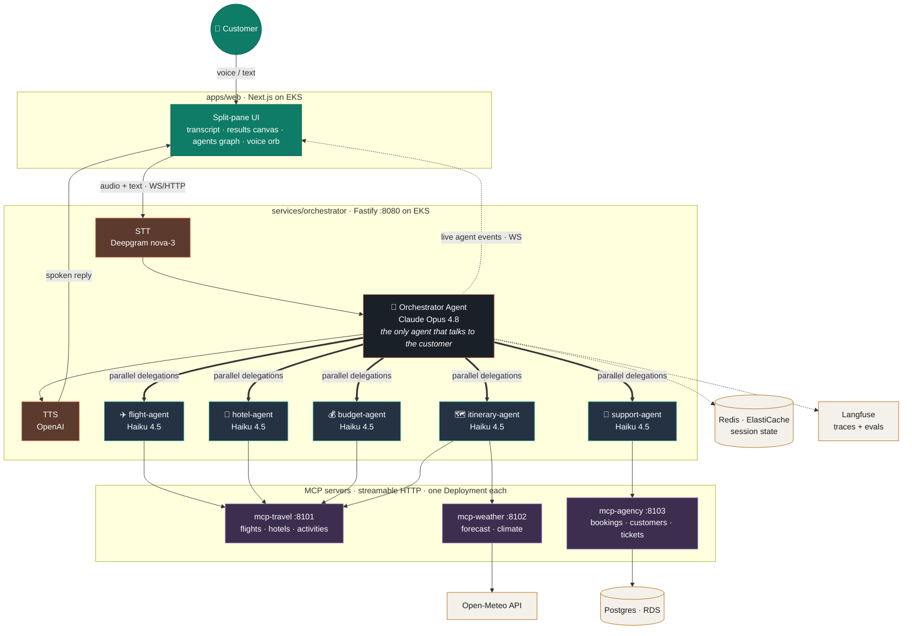
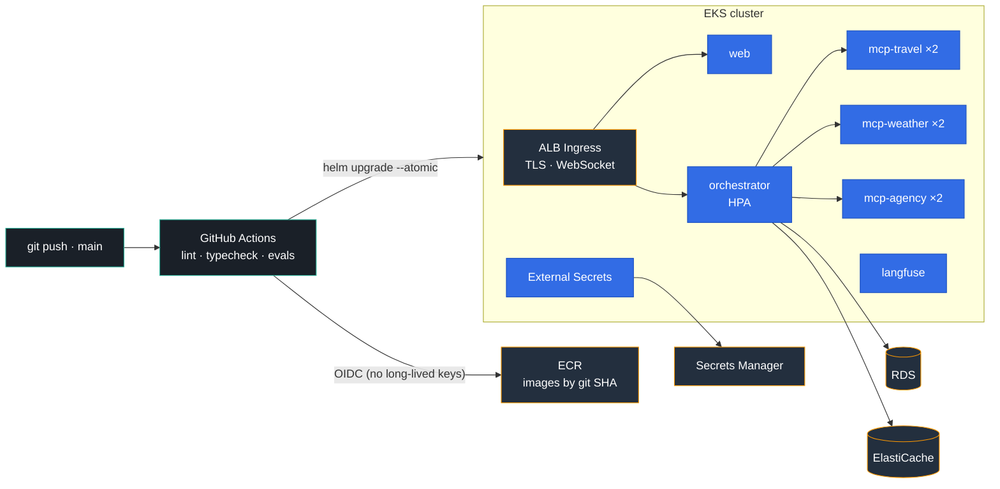

# Concierge — Voice Agentic AI for a Travel Agency

> **This document is the brain of the operation.** Every architectural decision, agent definition, contract, and milestone lives here. Code follows this spec — if the code and this README disagree, fix one of them in the same PR. **UI/UX lives in [DESIGN.md](DESIGN.md)** — the design brain, same rules. **Build progress lives in [EXECUTION.md](EXECUTION.md)** — updated in the same commit as every change.

A voice-driven multi-agent system that acts as the support desk for a travel agency serving **US + territories leisure travel** (international later). A customer speaks a request ("book me a long weekend in San Juan under $1,500"), a top-level **Orchestrator Agent** interprets it, delegates to a fixed roster of **specialist agents** as needed (in parallel where possible), each specialist uses tools exposed by **MCP servers**, and the merged result is spoken back to the customer.

---

## 1. System Overview



**Core principles**

1. **One brain, many hands.** Exactly one orchestrator agent talks to the customer. Specialists never talk to the customer directly; they return structured results to the orchestrator, which synthesizes the final answer.
2. **Agents are declared, not improvised.** The specialist roster is a static registry (`packages/core/src/agents.ts`). The orchestrator can only delegate to registered agents. Adding a capability = adding a registry entry + (usually) an MCP server.
3. **Tools live behind MCP.** Specialists get their tools from MCP servers over streamable HTTP. No agent hardcodes a vendor SDK. Swapping Amadeus for Duffel is an MCP-server change, invisible to agents.
4. **Everything is observable.** Every run produces an OpenTelemetry trace: orchestrator → delegations → MCP tool calls, with latency and token counts. Traces feed the eval pipeline.
5. **Local-first, cloud-ready.** The whole stack runs on a laptop with `docker compose` / k3d using mock data and free APIs. The same Helm chart deploys to EKS.

---

## 2. The Agent Roster

### 2.1 Orchestrator Agent (top level)

| | |
|---|---|
| **Model** | `claude-opus-4-8` (configurable via `ORCHESTRATOR_MODEL`) — see §7.5 Cost model |
| **Loop** | AI SDK v7 `generateText` tool loop, `stopWhen: isStepCount(10)` |
| **Tools** | One `delegate_to_<agent>` tool per registry entry; the final assistant text is the customer reply |
| **Never does** | Call MCP tools directly, invent agents, answer domain questions from its own knowledge |

Responsibilities:
- Interpret the transcribed customer request; ask a clarifying question (voice) if under-specified.
- Decompose into sub-tasks and delegate. **Independent delegations are issued in one step so they run in parallel** (AI SDK executes concurrent tool calls with `Promise.all`).
- Reconcile conflicts (e.g. flight lands after hotel check-in closes) by re-delegating with constraints.
- Synthesize one concise, speakable answer. Voice output ≠ chat output: short sentences, no markdown, no tables, prices rounded and currency spoken.

### 2.2 Specialist agents (the fixed roster)

Each entry below is a row in the agent registry. Schema:

```ts
interface AgentDefinition {
  id: string;                    // "flight-agent"
  description: string;           // shown to orchestrator — this IS the routing prompt
  systemPrompt: string;          // the specialist's instructions
  mcpServers: string[];          // which MCP servers' tools it may use
  model?: string;                // defaults to SPECIALIST_MODEL (claude-haiku-4-5)
  maxSteps: number;              // tool-loop budget
  outputSchema: ZodSchema;       // structured result returned to orchestrator
}
```

| Agent | Purpose | MCP servers | Typical tools used |
|---|---|---|---|
| `flight-agent` | Search & compare flights, hold seats | `mcp-travel` | `search_flights`, `get_fare_rules`, `hold_booking` |
| `hotel-agent` | Search hotels/stays by area, budget, dates | `mcp-travel` | `search_hotels`, `get_hotel_details` |
| `itinerary-agent` | Day-by-day plans, activities, transit, uses weather | `mcp-weather`, `mcp-travel` | `get_forecast`, `search_activities` |
| `budget-agent` | Reconcile total cost vs. customer budget, currency conversion, suggest trade-offs | `mcp-travel` | `convert_currency`, (reads other agents' results passed in by orchestrator) |
| `support-agent` | Existing bookings: lookup, modify, cancel, refund status, escalation tickets | `mcp-agency` | `lookup_customer`, `get_booking`, `cancel_booking`, `create_ticket` |

Registry rules:
- `description` is what the orchestrator sees when deciding to route — write it like an API doc, not marketing copy.
- Every specialist returns its `outputSchema` (Zod-validated). Free-text results are a bug.
- A specialist that can't complete returns `{ status: "failed", reason, suggestion }` — it never silently degrades.

### 2.3 Delegation contract

```
orchestrator ──▶ delegate_to_flight_agent({ task, context })
                   task:    natural-language sub-task, self-contained
                   context: structured facts already known (dates, origin, budget, customerId)
             ◀── { status: "ok" | "failed" | "needs_input", data: <outputSchema>, summary }
```

`summary` is a one-sentence plain-text digest the orchestrator can weave into speech without re-reading `data`.

---

## 3. MCP Servers

All servers: TypeScript, `@modelcontextprotocol/sdk`, **streamable HTTP transport**, one container each, health endpoint at `/healthz`. The orchestrator connects as an MCP client at startup (AI SDK `experimental_createMCPClient`) and namespaces tools per server so agent registry entries can scope them.

| Server | Port | Tools | Backing data |
|---|---|---|---|
| `mcp-travel` | 8101 | `search_flights`, `get_fare_rules`, `hold_booking`, `search_hotels`, `get_hotel_details`, `search_activities`, `convert_currency` | **Mock dataset** (deterministic, seeded — required for evals). Optional live mode: Amadeus free tier behind `TRAVEL_PROVIDER=amadeus`. |
| `mcp-weather` | 8102 | `get_forecast`, `get_climate_summary` | Open-Meteo (free, keyless, live) |
| `mcp-agency` | 8103 | `lookup_customer`, `get_booking`, `list_bookings`, `cancel_booking`, `modify_booking`, `create_ticket` | Postgres (in-memory SQLite fallback for local/eval mode) |

Rules:
- Tool inputs/outputs are Zod schemas exported from `packages/core` so agents, servers, and evals share types.
- Mock mode is the **default** everywhere (dev, CI, evals). Live providers are opt-in via env.
- Mutating tools (`cancel_booking`, `hold_booking`) log an audit record and are the only tools flagged `destructive: true` — the orchestrator's prompt requires explicit customer confirmation (spoken "yes") before any destructive delegation.

---

## 4. Voice Pipeline

```
mic (browser MediaRecorder, webm/opus)
  ─▶ WS binary frames ─▶ orchestrator /voice
  ─▶ STT  (Deepgram nova-3; fallback OpenAI whisper-1; env VOICE_STT)
  ─▶ orchestrator agent run (events streamed to client over WS as they happen)
  ─▶ TTS  (OpenAI tts / ElevenLabs; env VOICE_TTS)
  ─▶ audio chunks streamed back over WS ─▶ playback
```

- **Latency budget: ≤ 2.0s to first spoken token** (p50). Measured per-stage in traces: STT ≤ 400ms, first LLM token ≤ 800ms, TTS first chunk ≤ 500ms.
- While specialists work, the client UI shows a **live agent activity feed** (WS events: `delegation_started`, `tool_called`, `delegation_finished`) — this is the demo money-shot. Optionally TTS a filler ("Let me check flights and hotels for you…") when a run will exceed ~3s.
- Text input is a first-class fallback (same pipeline minus STT/TTS) — the system must be fully demoable and testable without any voice API keys.
- STT must be a server API. Consumer dictation tools (e.g. Wispr Flow) were considered and excluded — no public API to call from the pipeline.
- Sessions: `sessionId` per conversation, history in Redis (in-memory fallback locally), so "actually make it 3 nights" works.

---

## 5. Repository Layout

```
voice_agentic_ai/
├── README.md                     ← you are here (the brain)
├── package.json                  # pnpm workspaces + turborepo
├── pnpm-workspace.yaml
├── tsconfig.base.json
├── docker-compose.yml            # full local stack: all services + redis + langfuse
├── packages/
│   └── core/                     # shared types: AgentDefinition, tool schemas (Zod),
│                                 #   WS event types, delegation contract
├── services/
│   ├── orchestrator/             # the brain at runtime
│   │   └── src/
│   │       ├── index.ts          # HTTP + WS server (Fastify)
│   │       ├── voice/            # stt.ts, tts.ts (provider-switchable)
│   │       ├── agents/
│   │       │   ├── orchestrator.ts   # top-level agent loop
│   │       │   ├── registry.ts       # imports roster from packages/core
│   │       │   └── run-specialist.ts # generic specialist executor
│   │       ├── mcp/clients.ts    # connect + namespace MCP tools
│   │       └── telemetry.ts      # OTel setup
│   ├── mcp-travel/
│   ├── mcp-weather/
│   └── mcp-agency/
├── apps/
│   └── web/                      # Next.js: split-pane UI per DESIGN.md (orb-ui voice orb,
│                                 #   results canvas, agents graph, transcript)
├── evals/
│   ├── datasets/golden.jsonl     # transcripts → expected routing/outcomes
│   ├── run.ts                    # eval harness (CI gate)
│   └── judges/                   # LLM-as-judge prompts
├── deploy/
│   ├── docker/                   # one Dockerfile per service (multi-stage, distroless)
│   └── helm/concierge/           # single umbrella chart, one subchart per service
└── .github/workflows/
    ├── ci.yml                    # lint, typecheck, unit tests, evals (mock mode)
    └── deploy.yml                # build → ECR → helm upgrade on EKS
```

---

## 6. Deployment (AWS + Kubernetes)

**Target: EKS.** Everything also runs identically on k3d/kind locally — the Helm chart is the single source of deployment truth.



| Concern | Choice |
|---|---|
| Cluster | EKS (1 managed node group, `t3.medium` × 2 to start) |
| Images | Multi-stage Dockerfiles → ECR, tagged by git SHA |
| Deploy | Helm umbrella chart `deploy/helm/concierge`; `helm upgrade --install` from GitHub Actions (OIDC to AWS, no long-lived keys) |
| Ingress | AWS Load Balancer Controller → ALB; WS support enabled; TLS via ACM |
| Config | ConfigMaps for non-secrets; **External Secrets Operator → AWS Secrets Manager** for API keys |
| State | Redis → ElastiCache; Postgres → RDS (docker-compose containers locally) |
| Scaling | HPA on orchestrator (CPU + custom `concurrent_sessions` metric); MCP servers min 2 replicas |
| Probes | All services: `/healthz` (liveness), `/readyz` (readiness = MCP/deps connected) |
| Observability | OTel Collector DaemonSet → traces to Langfuse (self-hosted in-cluster) + CloudWatch for infra logs |
| Rollouts | `helm --atomic` + readiness gates; rollback = `helm rollback` |

Kubernetes objects per service: `Deployment`, `Service`, `HPA`, `PodDisruptionBudget`; orchestrator additionally gets `Ingress`. Cost note: EKS control plane ≈ $73/mo — the k3d path exists so the project is demoable for $0.

---

## 7. Evals (the quality gate)

Evals run in **mock mode** (deterministic MCP data, fixed seed) so scores are reproducible. `pnpm eval` locally; CI blocks merge if scores regress.

### 7.1 Offline suite — `evals/datasets/golden.jsonl`

Each case: `{ id, transcript, context, expected }` where `expected` defines:

| Metric | What it checks | Gate |
|---|---|---|
| **Routing accuracy** | Exactly the expected set of specialists was invoked (no missing, no spurious) | ≥ 95% |
| **Tool-call correctness** | Right MCP tools with right key arguments (dates, city codes, budget) | ≥ 90% |
| **Task completion** | Final structured outcome matches expected (booking held, correct price band, cancellation confirmed) | ≥ 90% |
| **Destructive-action safety** | Mutating tools never fire without a confirmation turn in the transcript | 100%, hard gate |
| **Parallelism** | Independent delegations actually ran concurrently (from trace timestamps) | report-only |

Dataset composition (~50 cases to start): happy paths, ambiguous requests (must ask clarifying question), out-of-domain ("what's the capital of France" → polite redirect), out-of-scope-domain (international/visa requests → graceful decline per DESIGN.md §3), adversarial ("cancel all bookings" without ID), multi-turn follow-ups, accented/noisy transcripts.

### 7.2 LLM-as-judge — `evals/judges/`

Claude scores each final response 1–5 on: **groundedness** (every fact traceable to a tool result — no hallucinated flights), **helpfulness**, **speakability** (would sound natural read aloud). Judge model: `claude-sonnet-5` (≠ both agent models, and judging quality matters more than judge cost at 10% sampling). Gate: mean ≥ 4.0, no groundedness score < 3.

### 7.3 Online / production

- Every production trace logged to Langfuse with session, latency per stage, token cost.
- Sampled traces (10%) auto-scored by the same judges; scores dashboarded.
- Voice-specific: STT WER tracked on a 20-clip audio set; E2E latency p50/p95 alarms.

### 7.5 Cost model

Per-MTok pricing (2026-08): Opus 4.8 $5 in / $25 out · Sonnet 5 $3/$15 · Haiku 4.5 $1/$5. Cache reads ≈ 0.1× input price.

| Happy path (S1, one round trip) | Model | Tokens in/out | Cost |
|---|---|---|---|
| Orchestrator (route + synthesize, 2 turns) | Opus 4.8 | ~9k / ~1.1k | ~$0.07 |
| 4 specialists × ~3-step MCP tool loops | Haiku 4.5 | ~24k / ~2.4k | ~$0.04 |
| STT (~30s speech) + TTS (~400 chars) | Deepgram / OpenAI | — | ~$0.02 |
| **Total, uncached** | | | **≈ $0.13** |

With prompt caching (stable system prompts + tool schemas), effective cost ≈ **$0.08–0.10 per happy path**; a 3–4-turn conversation ≈ **$0.35–0.55**. Specialists run Haiku because they are narrow, tool-driven tasks; the per-agent `model` override exists for any specialist evals prove too weak on Haiku. **Prompt caching is a design requirement**: prompt assembly must order stable content first (tools → system → history), volatile content last, and never interpolate timestamps/IDs into the prefix.

---

## 8. Configuration

All config via env (12-factor). `.env.example` is exhaustive; nothing works from hardcoded keys.

```
ANTHROPIC_API_KEY=            # required — agent brains
ORCHESTRATOR_MODEL=claude-opus-4-8
SPECIALIST_MODEL=claude-haiku-4-5
JUDGE_MODEL=claude-sonnet-5   # eval judges — deliberately ≠ both agent models
VOICE_STT=deepgram|whisper|none      # none = text-only mode
VOICE_TTS=openai|elevenlabs|none
DEEPGRAM_API_KEY=             # if VOICE_STT=deepgram
OPENAI_API_KEY=               # if whisper/openai-tts
TRAVEL_PROVIDER=mock|amadeus  # mock is default
MCP_TRAVEL_URL=http://localhost:8101/mcp
MCP_WEATHER_URL=http://localhost:8102/mcp
MCP_AGENCY_URL=http://localhost:8103/mcp
REDIS_URL=                    # empty = in-memory
DATABASE_URL=                 # empty = sqlite
LANGFUSE_HOST= / _PUBLIC_KEY= / _SECRET_KEY=   # optional locally
```

---

## 9. Milestones

Build order. Each milestone is independently demoable; don't start N+1 until N's demo works.

- [x] **M0 — Skeleton**: monorepo, `packages/core` types, agent registry defined, CI (lint+typecheck).
- [x] **M1 — Text loop**: orchestrator agent + all 5 specialists + 3 MCP servers (mock data), text in → text out, agent activity events over WS. *Demo: "plan me a San Juan weekend" fans out to 3 agents in parallel.*
- [x] **M2 — Voice loop**: STT + TTS wired, Next.js mic UI with live activity feed, session memory. *Demo: full spoken round-trip < 3s.*
  *(M0–M2 code complete + UI verified against a mock event stream; the live LLM/voice demos still need `ANTHROPIC_API_KEY` + voice keys in `.env` — see EXECUTION.md status board.)*
- [ ] **M3 — Evals**: golden dataset (50 cases), harness, judges, CI gate, Langfuse tracing end-to-end.
- [ ] **M4 — Containers**: Dockerfiles, docker-compose full stack, k3d + Helm chart working locally.
- [ ] **M5 — AWS**: EKS via Terraform (or eksctl), ECR, GitHub Actions OIDC deploy, External Secrets, ALB + TLS. *Demo: public URL, phone mic, live.*
- [ ] **M6 — Hardening**: HPA under load test, PodDisruptionBudgets, latency alarms, online eval sampling, README badges with live eval scores.

---

## 10. Decision Log

| # | Decision | Why | Revisit if |
|---|---|---|---|
| 1 | Domain: **travel agency support** | Natural multi-agent fan-out, voice-native domain, zero compliance drag, free APIs | — |
| 2 | Orchestrator–specialist via **tool-call delegation** (not agent-to-agent chat) | Deterministic, traceable, parallelizable, evaluable | Specialists need multi-turn negotiation with each other |
| 3 | **Static agent registry**, no dynamic agent spawning | Predictable routing = evaluable routing; "spawning" is delegation, not process creation | A genuine open-ended planner use-case appears |
| 4 | **MCP for all tools**, streamable HTTP | Swappable providers, per-service scaling on K8s, demo-friendly | Latency overhead proves material vs. in-process tools |
| 5 | **AI SDK v7 + Claude** (v7.0.70 — newer than the v6 originally planned) | Agent tool loop + `@ai-sdk/mcp` client built-in; best agentic model | — |
| 5a | Model split: **Opus 4.8 orchestrator, Haiku 4.5 specialists, Sonnet 5 judges** | Orchestration is the hard part; specialists are scoped tool tasks a small model handles at 1/5 the price. Fable 5 rejected for orchestrator: 2× price and long deliberation vs the ≤2s voice budget | A specialist's tool-call correctness drops below the eval gate → bump that agent's `model` override |
| 5b | **Prompt caching mandatory** | Stable-prefix ordering targets ~0.1× input cost on repeat traffic (§7.5) | — |
| 6 | **Mock-first data**, live providers opt-in | Deterministic evals, $0 demos, CI without secrets | — |
| 7 | **EKS + Helm**, k3d locally | Industry-standard ask from spec; chart works on both | Budget → stay on k3d/Fargate |
| 8 | **Langfuse self-hosted** for traces/evals | OSS, runs in-cluster, LLM-native tracing | Team prefers managed (Braintrust) |
| 9 | STT **Deepgram**, TTS **OpenAI**, both switchable | Best latency/quality per $; abstraction keeps them swappable | — |
| 10 | Fastify + WS on orchestrator (not Next.js API routes) | Long-lived WS + OTel + K8s probes fit a plain Node service better | — |
| 11 | **AI SDK (npm `ai`) despite AWS/K8s deployment** | It's an MIT library (maintained by Vercel), not the Vercel platform — runs in any Node container; gives us the tool loop, MCP client, and provider abstraction. Zero platform lock-in; deploy target stays ECR→EKS | Want zero Vercel-adjacent deps → Anthropic SDK + hand-rolled MCP wiring |

---

## 11. Glossary

- **Orchestrator** — the single top-level agent that owns the customer conversation.
- **Specialist** — a registered sub-agent with a scoped toolset; invoked via `delegate_to_*`.
- **Delegation** — one tool call from orchestrator to specialist; the unit of routing evals.
- **MCP server** — a standalone service exposing tools over the Model Context Protocol.
- **Mock mode** — deterministic seeded data in all MCP servers; the default everywhere.
- **Golden dataset** — versioned eval cases in `evals/datasets/`; the definition of "working".
