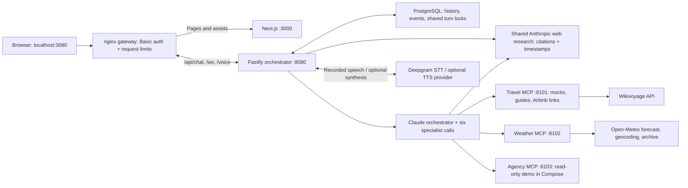

# Roam

A voice-enabled travel planning prototype for the US and its territories. Talk or type to a travel companion; flights, stays, itineraries and budgets appear on a trip board while specialist activity is visible alongside them.

**Status: working local prototype, not a hosted booking service.** Updated October 27, 2026:
- The trip board was redesigned.
- All six specialists and the orchestrator have Anthropic web search, with visible source links.
- Itinerary research uses sourced Wikivoyage listings where available; coverage and output quality are not guaranteed.
- It's **live on AWS** at https://98-95-105-10.sslip.io (password-protected; one t4g.small server, about $6/month). See [deploy/aws](deploy/aws/README.md).

Flights, hotels, rental cars and agency bookings use demo data. Airbnb defaults to direct search links, not live availability. See [Where the data comes from](#where-the-data-comes-from).

**New here? Read [Roam, explained in plain English](EXPLAINED.md)**: what it is, every tool it uses, and everything done from the first version to deployment, without jargon.

## Container preview

The protected Docker version runs at **http://localhost:3080**. Follow [container setup](deploy/README.md); the setup script stores your local login in `.secrets/tester-login.txt`. Seven services run locally, including PostgreSQL. Use HTTP on port 3080 in Chrome or Safari if an embedded browser cannot show the login prompt. To host it with HTTPS on AWS (one t4g.small host, about $6/month under the AWS T4g free trial through 2026), run `deploy/aws/deploy.sh up` from a signed-in AWS CLI; see [AWS deployment](deploy/aws/README.md).

## Run locally

Prerequisites: Node.js **22 or newer**, pnpm **11.22.0**, and an Anthropic API key with access to the configured models.

```bash
git clone https://github.com/rohansawant07/voice-agentic-ai.git
cd voice-agentic-ai
pnpm install --frozen-lockfile
cp .env.example .env
# Edit .env: set ANTHROPIC_API_KEY. Keep voice providers as none for text-only.
pnpm build
./scripts/dev.sh
```

Open **http://localhost:3000**. The script loads the root `.env` and starts five processes on ports 3000, 8080, 8101, 8102 and 8103. Start with those ports free. It sets each service's port separately so a global environment variable cannot put all services on the same port. Stop the stack with Ctrl+C. Package names still use the internal `@concierge/*` scope.

For voice input, set `VOICE_STT=deepgram` and `DEEPGRAM_API_KEY`, then restart the stack. Spoken replies are separate: set `VOICE_TTS=openai` plus `OPENAI_API_KEY`, or configure ElevenLabs. Deepgram credits currently cover transcription only. Voice uses recorded utterances, not live streaming recognition.

Individual package commands do **not** load root `.env` automatically. If running services separately, export the relevant variables yourself. Do not run a Next.js production build over a running development server's `.next` output; stop the web process, build, then restart it.

## Can someone else test it?

- **Yes, by cloning the public repository** and running the setup above with their own keys.
- **Not by opening your localhost link.** On their device, `localhost` means their own machine.
- A browser-only test needs a hosted frontend and reachable HTTP/WebSocket backend, or a protected temporary tunnel to both. HTTPS is needed for microphone use off localhost. A local protected Docker deployment is configured, and the AWS deployment at https://98-95-105-10.sslip.io serves HTTPS (needed for the microphone) behind Basic auth. Share its login only with people you trust; it's one shared identity.
- Before sharing your running backend, add access control and request limits. Direct development mode has no authentication. The container gateway now adds Basic authentication, session ownership scoping and request limits, but no per-user billing quota. CORS is not authentication; clients without an Origin header can call the backend. Shared demo agency mutations affect the same in-memory data.

See [testing and hosting requirements](docs/OPERATIONS.md). No deployment is triggered by pushing to GitHub.

## What works today

| Area | Implemented behavior |
| --- | --- |
| Conversation | Text requests, session history, same-session overlapping model turns rejected |
| Voice | Deepgram Nova-3 or Whisper transcription; optional OpenAI or ElevenLabs synthesis |
| UI | Responsive conversation / trip board; trip summary with picks, estimated total vs. budget and copyable plan; comparison rows with computed tags; live skeletons and step labels; day-tab itinerary; planning-activity timeline; follow-up suggestions; refresh-safe sessions with socket reconnect |
| Specialists | Six registered specialists: flight, hotel, itinerary, car rental, budget, support |
| Travel | Seeded flights/hotels/cars/activities; dietary filters; car rentals offered only when relevant/requested |
| Regional plans | Curated NPS planning facts for Harpers Ferry and Shenandoah; any other US destination uses live Wikivoyage listings (sourced, dated, community-edited), with places listed as closed on the trip dates removed in code |
| Weather | Open-Meteo forecasts within 16 days; beyond that, a curated table for demo destinations or observed averages for the month over the last three years. Place names resolve by state and territory ("Lake George, NY", "San Juan, Puerto Rico"); optional mock weather |
| Airbnb | Dated destination search links by default; opt-in independent connector with bounded concurrency/time and honest fallback |
| Agency | Seeded customers/bookings, simulated modifications/cancellations, tickets and audit records |
| Validation | Shared Zod schemas, HTTP input validation, deterministic regression and PostgreSQL integration tests, CI |

Picking a flight, stay or car updates the trip summary's estimated total and is remembered for the session. It does not book or hold anything, and it does not change the next model turn. No real reservation, payment, refund or ticket submission to a travel provider occurs. The opt-in Airbnb connector is not an official Airbnb integration; the live access check was restricted.

## Where the data comes from

Voice only converts speech. Deepgram turns recorded audio into text, which then follows exactly the same path as a typed message. Optional OpenAI or ElevenLabs synthesis reads the reply aloud. Planning is done by Claude: one orchestrator delegates to six specialists, and each specialist has its scoped MCP tools plus shared **public web search**. The orchestrator also has web search. Research includes source links and retrieval dates; it does not turn demo inventory into live availability.

| Data | Source | Live internet? |
| --- | --- | --- |
| Public web research | Anthropic native `web_search_20250305`, through the shared `search_web` tool | Yes; retrieved pages may still be stale |
| Reasoning (orchestrator and specialists) | Anthropic Claude | Yes |
| Speech to text / optional text to speech | Deepgram / OpenAI or ElevenLabs | Yes |
| Forecasts, geocoding, typical climate | Open-Meteo forecast, geocoding and historical archive APIs | Yes |
| Things to do for most US places | Wikivoyage listings (community-edited, cited, cached 6 h) | Yes |
| Harpers Ferry and Shenandoah planning facts | Curated National Park Service guides in code | No |
| Flights, hotels, rental cars, activities for demo destinations | Seeded demo inventory in code | No |
| Customers, bookings, refunds, tickets | Seeded demo agency data | No |
| Airbnb stays | A dated airbnb.com search link (live lookup is opt-in and off by default) | Link only |

Each specialist gets only the tools on its allowlist (`tools` in `packages/core/src/registry.ts`), plus `search_web`:

| Specialist | Tools it can call |
| --- | --- |
| Flights | `search_flights`, `get_fare_rules`, `hold_booking` (only with confirmation) |
| Stays | `search_vacation_rentals`, `search_hotels`, `get_hotel_details` |
| Itinerary | `get_destination_guide`, `search_activities`, `get_forecast`, `get_climate_summary` |
| Rental cars | `search_car_rentals` |
| Budget | `convert_currency` |
| Bookings | Agency tools: lookup, list, get, cancel, modify, ticket (demo bookings; mutations disabled in Compose) |
| Orchestrator | Specialist delegation + `search_web` |

Wikivoyage listings are rejected when they belong to a non-US place, a same-named town in another state, or a disambiguation page. Listings that state they are closed on the trip dates are removed in code before the model sees them. Prices from community guides are never totaled. Real fares and room rates would need a paid travel data provider; `TRAVEL_PROVIDER` and Amadeus settings are placeholders only.

## Architecture



Specialists run inside the orchestrator process; they are not six deployed workers. Independent delegations can run concurrently. The orchestrator and specialists use Anthropic through AI SDK v7. Defaults are `claude-opus-4-8` and `claude-haiku-4-5`, respectively; both are configurable. See [ARCHITECTURE.md](ARCHITECTURE.md) for the actual lifecycle and boundaries.

## Database and cache

The default `scripts/dev.sh` mode remains in-memory unless `DATABASE_URL` is set. The [Docker pilot](deploy/README.md) now configures PostgreSQL with persistent volumes, scoped identities, shared turn locks, bounded history and a shared activity log. No Redis is required.

### Direct local-development mode

Without `DATABASE_URL`, conversations and agency demo records are process-local. With it, migration `services/orchestrator/migrations/001-state.sql` is applied at startup and conversation/event state uses PostgreSQL. Agency demo records are not migrated; their mutations are disabled in Compose. There is no SQLite fallback or Redis.

| State / cache | Where it lives | Retention and limits |
| --- | --- | --- |
| Conversation history | Orchestrator `Map`, keyed by session ID | Successful user/assistant pairs only; no TTL or size bound; lost on restart |
| Active-turn guard | Orchestrator `Set` | Released after each model turn; process-local only |
| Activity replay | Orchestrator event bus | Up to 500 events per session; no session expiry or global bound |
| Customers/bookings/tickets/audit | Agency arrays | Shared demo store; mutations lost on agency restart |
| MCP tool definitions | Orchestrator `Map` | Discovered once at startup; no automatic refresh |
| Wikivoyage guide responses | Travel-service process-local cache | 6-hour TTL, at most 200 entries; lost on restart |
| Web search/weather/model responses | No application result cache | Repeated requests repeat tool/provider work |
| Provider prompt cache | No explicit cache configuration or hit metrics | Stable prompt ordering exists; savings/hits are not verified |

The browser keeps the session ID, settled messages and picks in localStorage, so a refresh resumes the trip. The activity socket reconnects and replays the session's events without duplicating them. **New trip** clears them. These constraints apply to direct in-memory mode. PostgreSQL mode coordinates history, locks and events across instances; the single-host pilot is not high availability. See [operations](docs/OPERATIONS.md) for the suggested next steps.

## Measured performance

A reproducible local benchmark and raw observations are in [PERFORMANCE.md](docs/PERFORMANCE.md) and [the benchmark data](docs/benchmarks/2026-10-26-local.json). These are serial development-machine measurements, **not** a production SLA or capacity test. HTTP liveness response time is not planning latency.

| Scenario | Median | Slowest of 3 runs |
| --- | --- | --- |
| Clarifying text reply | 2.33 s | 2.96 s |
| Harpers Ferry itinerary | 17.21 s | 20.74 s |
| Multi-specialist San Juan trip | 38.10 s | 46.33 s |
| Synthetic voice clip → transcript, after audio end | 0.26 s | 0.78 s |

All nine text requests returned HTTP 200; one specialist attempt failed and recovered on retry. Voice used a 5.392-second synthetic clip. Recording time is excluded, TTS was off, and first audible reply latency remains unmeasured. Small-sample p95 is just the maximum here; it is not a production tail estimate.

```bash
# Health/page response timing only; no model calls
node scripts/benchmark.mjs --output docs/benchmarks/latest.json

# Three fresh-session requests per scenario; uses paid model requests
node scripts/benchmark.mjs --live --runs 3 --output docs/benchmarks/latest.json
```

Existing activity events record total model-turn and specialist duration. There is no metrics dashboard, token/cost accounting, per-tool duration, cache-hit reporting, or STT/TTS timing instrumentation. The old two-second voice target was a goal, not a measured achievement. The browser waits for `tts_end` before playback.

## Configuration

[.env.example](.env.example) lists the implemented settings. Keep actual secrets in ignored `.env` files and server-side only. `NEXT_PUBLIC_ORCH_URL` is deliberately public and must be set **before building** a deployed frontend. `WEB_ORIGIN` must match its exact origin. Internal MCP URLs should not be publicly exposed.

`DATABASE_URL` now enables PostgreSQL conversation/event persistence. `AUTH_MODE=proxy` and `GATEWAY_TOKEN` protect deployed backend access. `REDIS_URL`, `LANGFUSE_*`, `TRAVEL_PROVIDER` and Amadeus credentials remain unimplemented placeholders. `JUDGE_MODEL` is read only by the offline itinerary eval ([docs/evals](docs/evals/README.md)). Docker Compose and a single-host AWS stack (CloudFormation, Caddy HTTPS, SSM secrets, daily snapshots) are present; Helm, EKS, an active AWS deployment and tracing are not. A paid, offline itinerary grounding eval exists (`scripts/eval-itinerary.mjs`); other specialists have no evals yet.

## Known research-quality limits

The latest committed itinerary evaluation passed **0 of 4 cases** despite passing judge calibration. Findings include invented or retitled stops, unsupported descriptions, incorrect day counts and structured-output failures. Web search is available, but the specialist did not choose it in those four cases. The successful NPS search smoke test confirms connectivity, not itinerary correctness. See [evaluation evidence](docs/evals/README.md). Historical latency measurements above predate web search and are not current search-enabled benchmarks.

## Development

```bash
pnpm lint
pnpm typecheck       # builds workspace, then checks types
pnpm test           # offline tests; PostgreSQL integration needs TEST_DATABASE_URL
pnpm build
```

CI runs these checks on pushes to `main` and pull requests. It does not deploy or run live-provider benchmarks. For a production-mode local web server, run the web build and `pnpm --filter @concierge/web start`; the backend services must also be running.

| Path | Purpose |
| --- | --- |
| `apps/web` | Next.js app and browser session hook |
| `services/orchestrator` | Chat, voice, model delegation, session store and event bus |
| `services/mcp-travel` | Mock travel inventory, curated NPS guides, Wikivoyage listings, Airbnb link/connector logic |
| `services/mcp-weather` | Open-Meteo forecasts, region-aware geocoding, curated and observed climate |
| `services/mcp-agency` | Simulated customer and booking operations |
| `packages/core` | Registry, schemas, event contracts |
| `packages/mcp-kit` | Shared stateless HTTP MCP server and US place parsing |
| `scripts` | Local launcher and latency benchmark |
| `deploy` | Docker gateway config and the AWS single-host kit (`deploy/aws/deploy.sh`) |
| `.agents/skills` | Imported design, accessibility and React guidance |

Project-local UI skills are documented in [SOURCES.md](.agents/skills/SOURCES.md), with pinned revisions and attribution. Their upstream README is kept intact. See [AGENTS.md](AGENTS.md) for routing.

## Project documents

- [Roam, explained in plain English](EXPLAINED.md): a non-technical walkthrough of the whole project and its deployment.
- [Project handoff](MEMORY.md): durable project context, constraints and next steps.
- [Architecture](ARCHITECTURE.md): implemented topology and data flow.
- [Interface design](DESIGN.md): current UI and behavior.
- [Operations](docs/OPERATIONS.md): sharing, state/cache design and deployment gaps.
- [Performance](docs/PERFORMANCE.md): method, measurements and limitations.
- [Execution history](EXECUTION.md): current status and historical changes.

## Shared web research (October 27, 2026)

All six specialists and the orchestrator now have `search_web`. It runs a bounded Anthropic native `web_search_20250305` research call using the existing server-side Anthropic key; no extra MCP service or search-provider key is needed. Defaults: enabled, Haiku 4.5, two research calls per agent run, up to two provider searches per research call, 25-second research deadline and 1,800 output tokens. This adds Anthropic usage; these limits are per agent run, not per-user spending quotas.

Set `WEB_SEARCH_ENABLED=false` to disable it or `WEB_SEARCH_MODEL` to choose a compatible Anthropic model. Compose forwards both settings. The Anthropic organization must permit web search. A live check with the configured account returned the official NPS Harpers Ferry operating-hours page.

Research returns a summary, HTTP(S) source URLs and retrieval timestamps. Sources are retained with specialist completion events and shown under **Planning activity → Web sources**; direct orchestrator research appends sources to its reply. Provider errors and results without citations return an explicit unavailable result. No application search cache is added.

Search is for current public facts, not guaranteed real-time inventory. Mock flights/hotels/cars remain demo inventory; Airbnb remains direct links; private booking records still require agency tools. Agents are instructed to exclude personal/booking details from queries and treat retrieved content as untrusted evidence. These are model instructions, not a complete data-loss-prevention system.

Provider reference: https://ai-sdk.dev/providers/ai-sdk-providers/anthropic
